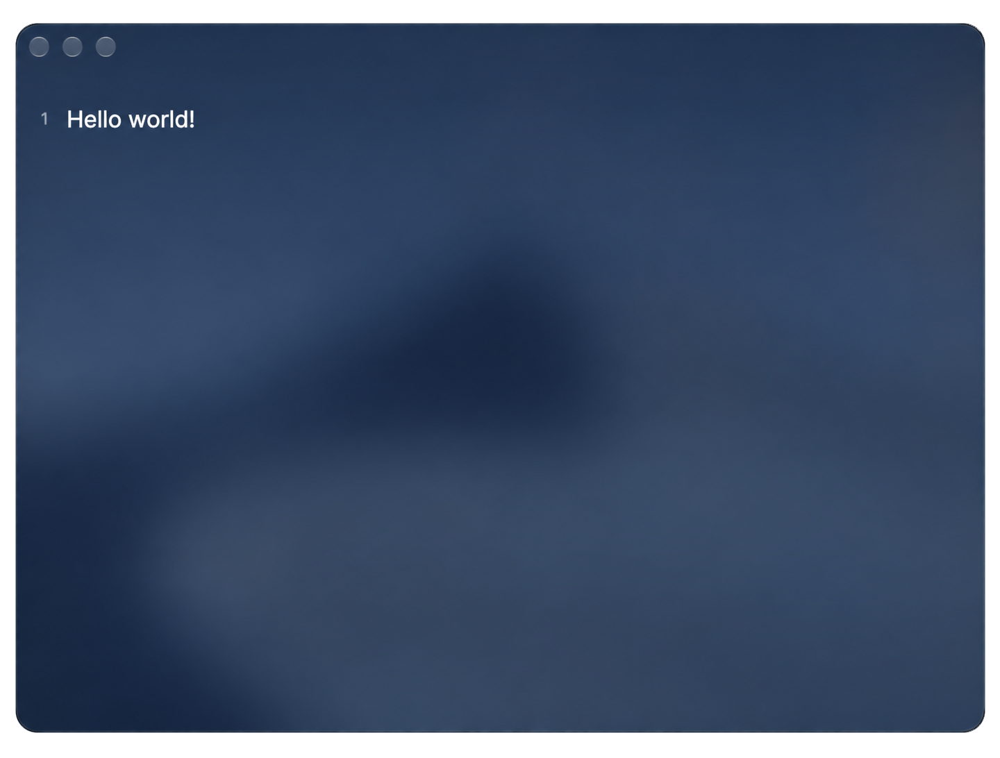

# Vitro



Um editor de notas minimalista e nativo para macOS. Texto rico com checklists
interativos, organizado em abas de janela nativas, envolto em Liquid Glass.

## Recursos

- **Notas em texto rico** com checkboxes clicáveis em linha.
- **Abas de janela nativas do macOS** — cada nota é uma janela com abas de verdade (`⌘1`, `⌘2`, …,
  arraste para reordenar, `+` para adicionar). No macOS 26 (Tahoe), a barra de abas e a barra de
  título recebem o tratamento Liquid Glass do sistema; o conteúdo do editor flutua sobre uma base
  de vibrancy fosca.
- **Títulos derivados do seu texto** — a primeira linha não vazia nomeia a nota, no estilo do
  Apple Notes. Sem campo de título para gerenciar.
- **Armazenamento sempre ativo, sem arquivos.** As notas são salvas automaticamente como JSON;
  você só toca o sistema de arquivos quando **Exporta** uma nota para Markdown.
- **Uma única tipografia, Inter**, em todo o app.

## Requisitos

- **macOS 26 (Tahoe) ou superior** — o Liquid Glass e o comportamento de abas nativas dependem do
  SDK do Tahoe.
- Xcode 26+ / Swift 6.
- [XcodeGen](https://github.com/yonaskolb/XcodeGen) (`brew install xcodegen`) para regenerar o
  projeto Xcode a partir de `project.yml`.
- A fonte [Inter](https://rsms.me/inter/) instalada (o app volta para a fonte do sistema caso ela
  não esteja).

## Como compilar e executar

```sh
# Compila, instala em /Applications e abre:
sh scripts/run-local.sh
```

Para uma checagem rápida de compilação durante o desenvolvimento:

```sh
swift build
```

Se você adicionar, remover ou renomear um arquivo-fonte, regenere o projeto Xcode primeiro:

```sh
xcodegen generate
```

> A compilação é **assinada ad-hoc** para uso local — ela roda no seu Mac, mas não é notarizada
> para distribuição. Enviar para outras máquinas exige um certificado Developer ID.

## Atalhos de teclado

| Atalho      | Ação                                  |
| ----------- | ------------------------------------- |
| `⌘T`        | Nova aba                              |
| `⌘W`        | Fechar aba                            |
| `⌘S`        | Exportar para Markdown                |
| `⌘⇧L`       | Inserir checklist                     |
| `⌘+` / `⌘-` | Aumentar / diminuir o tamanho da fonte |
| `⌘0`        | Redefinir o tamanho da fonte          |

## Estrutura do projeto

- `Sources/Vitro/Window/` — camada de janela/abas em AppKit (`NoteWindow`,
  `NoteWindowController`, `TabController`).
- `Sources/Vitro/Editor/` — o editor de texto rico baseado em `NSTextView`, os checkboxes e a
  régua de números de linha.
- `Sources/Vitro/Models/` — `Note` e a `NotesStore` que as persiste.
- `main.swift` / `VitroApp.swift` — ponto de entrada em AppKit puro e o menu.

Veja [AGENTS.md](AGENTS.md) para a arquitetura em profundidade.

## Licença

Distribuído sob a licença MIT. Veja [LICENSE](LICENSE) para os termos completos.
